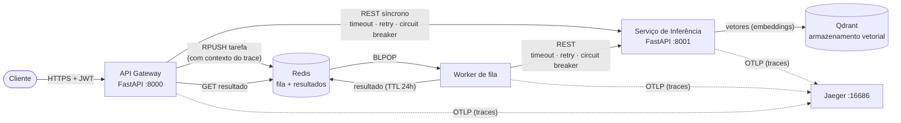

# Plataforma de IA como Serviço — C3.A2

**Sistemas Distribuídos e Computação em Nuvem · FAESA · 2026/2** — Prof. Howard Cruz Roatti

**Grupo:** Gabriel Herculino · Jonathan Prado · Julia Evellyn · Maurilio Marques

Plataforma cloud-native de análise de sentimento: o serviço de inferência do C1.A2
transformado em um sistema distribuído **conteinerizado, publicado na nuvem, observável e protegido**.
A IA é uma caixa-preta (modelo scikit-learn local); o foco é a engenharia distribuída.

## URL pública

> **https://SEU-DOMINIO.up.railway.app** ← *(substituir após o deploy — ver [deploy/RAILWAY.md](deploy/RAILWAY.md))*
>
> Documentação interativa: `<URL>/docs` · Saúde: `<URL>/saude`

---

## 1. Arquitetura



| Serviço | Pasta | Papel | Exposto? |
|---|---|---|---|
| **gateway** | `gateway/` | Porta de entrada única: JWT, rate limit, roteamento, publica na fila | **Sim** (único) |
| **inferencia** | `inferencia/` | Modelo do C1.A2 (carregado 1 vez) + grava/busca vetores no Qdrant | Não |
| **worker** | `worker/` | Consome a fila, chama a inferência, grava resultado, retentativa e dead-letter | Não |
| **redis** | imagem oficial | Fila de tarefas, resultados e contadores de rate limit | Não |
| **qdrant** | imagem oficial | Armazenamento vetorial (busca de textos similares) | Não |
| **jaeger** | imagem oficial | Coleta e exibe os traces distribuídos | Só o painel (local) |

**Dois caminhos de comunicação:**
- **Síncrono (REST):** `POST /predict` → gateway → inferência → resposta na hora.
- **Assíncrono (mensageria):** `POST /tarefas` → gateway publica no Redis e responde `202` com um `id`
  → worker consome e processa → cliente consulta `GET /tarefas/{id}`.

Os serviços se encontram **pelo nome** (`http://inferencia:8001`, `redis://redis:6379`),
nunca por IP fixo. Toda configuração vem de **variáveis de ambiente** (ver `.env.example`).
Cada serviço tem **seu próprio Dockerfile** e roda como usuário sem privilégio.

## 2. Como executar (do zero, com UM comando)

Pré-requisitos: Git e Docker (com Docker Compose).

```bash
git clone https://github.com/maurilio-marques/plataforma-ia-c3a2.git
cd plataforma-ia-c3a2
docker compose up --build
```

Pronto: gateway em http://localhost:8000 (Swagger em http://localhost:8000/docs) e
painel de traces em http://localhost:16686.
O `.env` é opcional; sem ele são usados os valores padrão. Para trocar segredos: `cp .env.example .env`.

### Testando (troque `URL` pela URL pública para testar na nuvem)

```bash
URL=http://localhost:8000

# 1) login -> token JWT
TOKEN=$(curl -s -X POST $URL/login -H "Content-Type: application/json" \
  -d '{"usuario":"aluno","senha":"senha-demo"}' | python -c "import sys,json;print(json.load(sys.stdin)['access_token'])")

# 2) sem token -> 401
curl -i -X POST $URL/predict -H "Content-Type: application/json" -d '{"texto":"oi"}'

# 3) inferência síncrona
curl -X POST $URL/predict -H "Authorization: Bearer $TOKEN" \
  -H "Content-Type: application/json" -d '{"texto":"o atendimento foi excelente"}'

# 4) inferência assíncrona (fila + worker)
curl -X POST $URL/tarefas -H "Authorization: Bearer $TOKEN" \
  -H "Content-Type: application/json" -d '{"texto":"produto quebrou no primeiro dia"}'
curl $URL/tarefas/<id-devolvido> -H "Authorization: Bearer $TOKEN"

# 5) busca no armazenamento vetorial
curl -X POST $URL/similares -H "Authorization: Bearer $TOKEN" \
  -H "Content-Type: application/json" -d '{"texto":"atendimento excelente","limite":3}'
```

No Windows, o jeito mais simples é usar o Swagger (`/docs`): faça o `/login`, copie o
`access_token`, clique em **Authorize** e teste as rotas.

### Rotas do gateway

| Método | Rota | Auth | Descrição |
|---|---|---|---|
| GET | `/saude` | — | Saúde do gateway e estado dos circuit breakers |
| POST | `/login` | — | Devolve o token JWT (expira em 30 min) |
| POST | `/predict` | JWT | Inferência síncrona |
| POST | `/tarefas` | JWT | Inferência assíncrona (202 + id) |
| GET | `/tarefas/{id}` | JWT | Estado/resultado: `queued`, `retrying`, `completed`, `failed`, `dead_letter` |
| POST | `/similares` | JWT | Textos mais parecidos (similaridade do cosseno no Qdrant) |

## 3. Resiliência

Aplicada nas chamadas **gateway → inferência** e **worker → inferência** (`resiliencia.py` de cada serviço):

| Mecanismo | Configuração (padrão) | Comportamento |
|---|---|---|
| **Tempo-limite** | `TIMEOUT_SEGUNDOS=3` | Nenhuma chamada fica pendurada |
| **Retentativa com espera progressiva** | `RETRY_TENTATIVAS=3`, espera 0,5s → 1s (exponencial, biblioteca `tenacity`) | Só para falhas transitórias (conexão, timeout, HTTP 5xx). 4xx não é repetido |
| **Circuit breaker** | `CB_FALHAS_MAX=5`, `CB_RESET_SEGUNDOS=30` (biblioteca `pybreaker`) | Após 5 falhas abre e responde 503 na hora; depois de 30s fica meio-aberto e testa 1 chamada |
| **Isolamento por rota** | um circuito para `/predict`, outro para `/similares` | Se o Qdrant cair, só `/similares` abre o circuito; `/predict` continua no ar |
| **Fila: retentativa + dead-letter** | `MAX_TENTATIVAS=3`, espera 2s → 4s | Tarefa volta para a fila; após 3 falhas vai para `dead_letter` (herdado do C1.A2) |
| **Degradação graciosa** | — | Qdrant fora → a inferência responde normalmente com `vetor_armazenado: false` |

Testes feitos (derrubando a inferência):

```
chamada 1-4: 503 em ~1,5s  "servico indisponivel apos retentativas"     (3 tentativas + backoff)
chamada 5:   503 em ~1,5s  -> circuito ABRE
chamada 6+:  503 em ~4ms   "circuito 'predict' aberto"                  (falha rápida)
inferência volta -> após o reset: open -> half-open -> closed, 200 OK
```

O estado dos circuitos aparece em `GET /saude`.

## 4. Observabilidade — rastreamento distribuído

Os três serviços são instrumentados com **OpenTelemetry** (exportação OTLP/HTTP para o **Jaeger**).
O ponto central é a **propagação do contexto pela fila**: o gateway injeta o `traceparent` dentro da
mensagem (`"trace": {...}`) e o worker o extrai, continuando **o mesmo trace** do outro lado do Redis.

Trace real de um `POST /tarefas`:

```
[gateway]    POST /tarefas
  [gateway]    fila.publicar          (span PRODUCER)
    [worker]     fila.consumir        (span CONSUMER, filho do publicar)
      [worker]     POST               (chamada HTTP para a inferência)
        [inferencia] POST /predict
          [inferencia] modelo.prever
          [inferencia] PUT            (gravação no Qdrant)
```

Para ver: `docker compose up`, faça uma requisição e abra http://localhost:16686
→ Service `gateway` → **Find Traces**. Cada linha de log do gateway também traz o `trace_id`.

## 5. Segurança

- **JWT no gateway:** `POST /login` emite um token HS256 assinado com `JWT_SEGREDO`, com expiração
  (`JWT_EXPIRA_MINUTOS=30`). Rotas sem token, com token inválido ou expirado → **401**.
  Senha comparada em tempo constante (`hmac.compare_digest`).
- **Rate limit:** `RATE_LIMIT_POR_MINUTO=30` por usuário (contador no Redis, vale para várias
  réplicas do gateway) e também no `/login` por IP (freia força bruta) → **429**.
- **HTTPS:** o serviço publicado no Railway só é acessado pelo domínio `*.up.railway.app`, com
  certificado TLS gerenciado pela plataforma. Os serviços internos ficam na rede privada, sem domínio público.
- **Superfície mínima:** só o gateway é exposto; Redis, Qdrant e inferência não publicam portas.
- **Segredos fora do código:** tudo em variáveis de ambiente; `.env` no `.gitignore`.
- **Containers sem root** e validação de entrada (texto de 1 a 5000 caracteres).

## 6. Conformidade — LGPD

| Dado tratado | Finalidade | Onde fica | Retenção |
|---|---|---|---|
| Usuário e senha do login | Autenticar o acesso | Senha **não é armazenada**: só comparada com a variável de ambiente | Nenhuma |
| Token JWT (contém só o usuário e a expiração) | Autorizar as chamadas | Com o cliente | Expira em 30 min |
| **Texto enviado para análise** (pode conter dado pessoal, se o usuário digitar) | Classificar o sentimento | Redis (dentro do resultado) | **24 horas** (TTL automático, `RETENCAO_RESULTADO_SEGUNDOS`) |
| Texto + vetor numérico + sentimento | Busca de textos similares | Qdrant | **7 dias** (limpeza automática de hora em hora, `VETOR_RETENCAO_DIAS`) |
| Usuário / IP em contadores de rate limit | Segurança (abuso e força bruta) | Redis | 60 segundos |
| Tarefas na dead-letter | Diagnóstico de falhas | Redis | Só **id + erro** (sem texto); no máximo 1000 itens |
| Traces (rota, status, tempos, endereço de rede da chamada) | Diagnóstico e desempenho | Jaeger (memória) | Até o Jaeger reiniciar; **sem o conteúdo do texto** |
| Logs | Operação | Saída dos containers | Registram método, rota, status, tempo e `trace_id`; **nunca o texto do usuário** |

- **Minimização:** o texto não aparece em logs, traces nem na dead-letter; o log de acesso padrão
  do uvicorn (que grava IP) está desligado.
- **Sem compartilhamento:** o modelo roda localmente (scikit-learn); nenhum texto é enviado a APIs de terceiros.
- **Eliminação:** todos os dados expiram automaticamente nos prazos acima.
- **Recomendação de uso:** por ser um projeto acadêmico, não envie dados pessoais reais.

## 7. Relatório de trade-offs

### CAP
Em uma partição de rede, o sistema precisa escolher entre **consistência** e **disponibilidade**. As escolhas foram feitas por componente:
- **Fila e resultados (Redis em nó único):** não há réplica, então não existe conflito entre cópias.
  Se o Redis ficar inacessível, `/tarefas` responde **503**: preferimos recusar a aceitar uma tarefa
  que poderia se perder. Nesse caminho a escolha é **consistência (CP)**.
- **Resultado assíncrono = consistência eventual:** logo após o `POST /tarefas` a consulta mostra
  `queued`; o resultado aparece só depois que o worker processa (~17 ms em média local, mais sob carga).
- **Rate limit:** se o Redis cair, o gateway **libera** as requisições (*fail-open*) para continuar atendendo.
  Aqui escolhemos **disponibilidade (AP)**, aceitando um limite impreciso por um tempo.
- **Armazenamento vetorial:** com o Qdrant fora, `/predict` continua respondendo e só o histórico vetorial
  deixa de ser gravado. Também é **disponibilidade**: o dado vetorial fica incompleto, mas o serviço principal não para.

### Custo
- Hospedado no **Railway (free tier)**: Trial com crédito único de US$ 5 por 30 dias, depois plano Free
  de US$ 1/mês. O custo é por uso (CPU, RAM e rede, cobrados por tempo).
- São **5 containers na nuvem** (gateway, inferência, worker, Redis, Qdrant). Para economizar:
  - o Jaeger fica opcional na nuvem; o rastreamento é demonstrado localmente;
  - o Qdrant roda sem volume, porque os vetores já têm retenção curta e a coleção é recriada sozinha;
  - o modelo é treinado no *build* da imagem, não a cada inicialização.
- Microsserviços custam mais que um monólito: cada serviço tem o seu container, a sua memória e
  a sua imagem. Em troca, cada parte escala e falha de forma independente (por exemplo, para mais
  carga basta adicionar workers).
- No plano Free, os serviços **dormem** quando ficam ociosos. Isso economiza crédito, mas a primeira
  requisição depois disso sofre *cold start*.

### Latência
Medições locais, sem Docker, com a pilha completa e 30 requisições cada:

| Caminho | Mediana | Observação |
|---|---|---|
| `POST /predict` (síncrono, via gateway) | ~13 ms | inclui JWT, rate limit, inferência e gravação no Qdrant |
| `POST /tarefas` (só enfileirar) | ~4 ms | o cliente é liberado na hora |
| Tarefa até `completed` | ~17 ms | fila + worker + inferência; o cliente precisa consultar depois |
| Falha com retentativas (serviço fora) | ~1,5 s | 3 tentativas com espera de 0,5 s e 1 s |
| Pior caso com tempo-limite (serviço travado) | até ~10,5 s | 3 tentativas × 3 s + esperas |
| Circuito aberto | ~4 ms | falha rápida, sem sobrecarregar o serviço doente |

- **Síncrono ou assíncrono:** o síncrono tem a menor latência total para uma requisição só.
  O assíncrono responde mais rápido ao cliente e aguenta picos (a fila absorve a carga),
  mas o resultado só chega depois e o cliente precisa consultar de novo.
- **Retentativa ou circuit breaker:** a retentativa melhora a chance de sucesso em falhas curtas,
  mas **soma latência**. O circuit breaker limita esse custo: depois de 5 falhas, o cliente recebe
  um erro em milissegundos em vez de esperar segundos.
- **Na nuvem:** soma-se o tempo de rede até o Railway e o *handshake* do TLS. Entre os serviços, a rede privada mantém os saltos rápidos.

## 8. Estrutura do repositório

```
plataforma-ia-c3a2/
├── gateway/        app.py · seguranca.py (JWT, rate limit) · resiliencia.py · telemetria.py · Dockerfile
├── inferencia/     app.py · modelo.py (C1.A2) · vetorial.py (Qdrant) · telemetria.py · Dockerfile
├── worker/         worker.py · fila.py (C1.A2) · resiliencia.py · telemetria.py · Dockerfile
├── deploy/         RAILWAY.md (passo a passo do deploy)
├── docker-compose.yml
├── .env.example
└── README.md
```

## 9. Divisão do trabalho

| Integrante | Responsabilidade |
|---|---|
| Gabriel Herculino | API Gateway: JWT, rate limit, roteamento síncrono/assíncrono, circuit breaker por rota |
| Jonathan Prado | Serviço de inferência (base do C1.A2) e armazenamento vetorial (Qdrant, retenção) |
| Julia Evellyn | Worker de fila, retentativa/dead-letter e rastreamento distribuído (propagação pela fila) |
| Maurilio Marques | docker-compose, deploy no Railway com HTTPS, README, LGPD e relatório de trade-offs |
